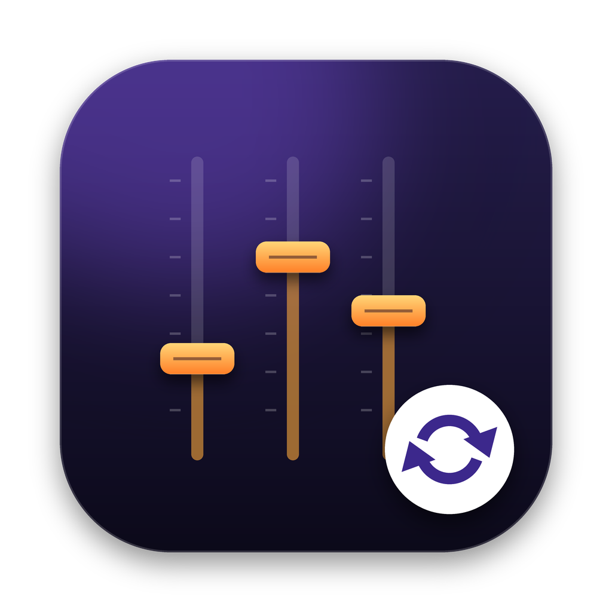

<p align="center">
  
</p>

<h1 align="center">CST to Patch</h1>

<p align="center">
  Convert your Logic Pro channel strip settings (<code>.cst</code>) into Logic 13 patches (<code>.patch</code>).<br>
  Your folder structure stays the same. Your original files stay untouched.
</p>

<p align="center">
  Created and powered by <a href="https://agsoundtrax.com">AGsoundtrax LLC</a>
</p>


## Why you need it

Logic Pro 13 no longer loads channel strip setting files (`.cst`) from the Library. It loads patches (`.patch`) instead. If you built a library of `.cst` presets over the years, you lose access to them after the update.

CST to Patch converts the whole library in one click. It keeps every folder you created, so your presets show up in Logic 13 in the same categories as before.

Real-world test: 811 `.cst` presets in 35 folders converted in under two minutes. Every converted patch carries a byte-for-byte copy of the original `.cst`.

## What it does

- Finds every `.cst` file in a folder and all its subfolders.
- Creates a `.patch` with the same name for each one, in the same folder structure.
- Copies `.patch` files you already have, if you want.
- Skips Logic projects (`.logicx`) and any patch that already exists. You can run it again safely.
- Never changes, moves or deletes your `.cst` files.

## Two ways to use it

| | Mac app | Command-line script |
|---|---|---|
| Best for | Most people | Automation, servers, power users |
| Needs | macOS 13 or later | Any Mac with bash |
| File | `CST to Patch.app` | `Scripts/convert-cst-to-patch.sh` |


## Option 1: The Mac app

### Download

1. Open the [Actions tab](../../actions) of this repository and click the latest green "Build" run.
2. Scroll to "Artifacts" and download `CST-to-Patch-unsigned`.
3. Unzip it and drag `CST to Patch.app` into your Applications folder.

The download from GitHub is not notarized. The first time you open it, macOS blocks it. To open it:

1. Right-click the app and choose Open.
2. Click Open in the dialog.

If macOS still refuses, open Terminal and run:

```bash
xattr -dr com.apple.quarantine "/Applications/CST to Patch.app"
```

You can also build the app yourself. See [Build from source](#build-from-source).

### Convert your presets

1. Open CST to Patch.
2. Step 1 shows the folder with your `.cst` presets. The default is:
   `~/Music/Audio Music Apps/Channel Strip Settings/Instrument`
   Click Change… or drag a folder from Finder onto the card to use another one.
3. Step 2 shows where the patches go. The default is Logic's patch folder:
   `~/Music/Audio Music Apps/Patches/Instrument`
4. The app scans the folder and shows how many presets, patches and folders it found, and how many are already converted.
5. Click Convert (or press Return).
6. When it finishes, click Show in Finder or Open Logic Pro.

### Find your patches in Logic 13

1. Open Logic Pro 13 and create a software instrument track.
2. Open the Library (press Y).
3. Your folders appear under Patches with the same names as before, for example `-= Pianos =-`.
4. Click a patch to load it.

### Options

- Also copy existing .patch files: copies patches you already have in the source folder, so the destination holds your full library.
- Open folder when done: opens the destination in Finder after a conversion.

### Tips

- Right-click a folder card to show it in Finder or copy its path.
- Click Show details after a conversion to see every file. Copy Log puts the full list on your clipboard.
- The app remembers your folders for next time.
- Press Esc to cancel a running conversion. Files converted so far are kept.

### Convert audio and other channel strips

The default folder holds instrument presets. Logic keeps other channel strip settings next to it, for example `Channel Strip Settings/Audio`. To convert those, pick that folder in Step 1 and `Patches/Audio` in Step 2.


## Option 2: The command-line script

```bash
git clone https://github.com/adigold/CST-Convertor.git
cd CST-Convertor
chmod +x Scripts/convert-cst-to-patch.sh
```

Convert everything with the default folders:

```bash
./Scripts/convert-cst-to-patch.sh
```

Choose your own folders:

```bash
./Scripts/convert-cst-to-patch.sh "SOURCE FOLDER" "DESTINATION FOLDER"
```

Test with the first 5 files only:

```bash
./Scripts/convert-cst-to-patch.sh "SOURCE FOLDER" "TEST FOLDER" 5
```

The script prints one line per file (`OK` or `SKIP`) and a summary at the end.


## How the conversion works

A Logic `.patch` is a folder (macOS shows it as one file) with two items inside:

```
My Piano.patch/
├── #Root.cst     your original .cst file, copied byte for byte
└── data.plist    small settings file Logic reads to list the patch
```

CST to Patch copies your `.cst` into the bundle as `#Root.cst`. It then writes `data.plist` with:

- `Channel_name`: the preset name (the `.cst` file name without extension)
- `Channel_chaStrCategory`: the name of the folder the preset sits in
- `UUID`: a new unique ID for each patch
- Default values for color, icon and sends, taken from a patch Logic created itself

Your sound (instrument, plugins, settings, effects) lives in `#Root.cst`, so nothing about the sound changes.

More detail: [docs/FORMAT.md](docs/FORMAT.md)


## Build from source

You need macOS 13 or later and Xcode (or the Command Line Tools: `xcode-select --install`).

```bash
git clone https://github.com/adigold/CST-Convertor.git
cd CST-Convertor
./build.sh
```

The app appears in `dist/CST to Patch.app`. This build is signed for your own Mac only.

### Signed and notarized build (for sharing)

You need an Apple Developer account and a "Developer ID Application" certificate in your Keychain.

1. Create an app-specific password at [account.apple.com](https://account.apple.com) under Sign-In and Security.
2. Copy the settings template and fill in your Apple ID and Team ID:

   ```bash
   cp signing.env.example signing.env
   open -e signing.env
   ```

3. Build:

   ```bash
   ./build.sh --notarize
   ```

4. The first time, the script asks for your app-specific password and saves it in your Keychain. It never writes it to a file.

The result is `dist/CST to Patch.zip`. Anyone can open it on their Mac without security warnings.

`signing.env` is in `.gitignore`. Never commit it.


## Project structure

```
CST-Convertor/
├── Sources/main.swift                SwiftUI app (single file)
├── Resources/
│   ├── Info.plist                    app bundle settings
│   ├── AppIcon-1024.png              icon source
│   └── AppIcon.icns                  prebuilt icon
├── Scripts/
│   ├── convert-cst-to-patch.sh       command-line converter
│   └── make_icon.py                  regenerates the icon (Python + Pillow)
├── docs/FORMAT.md                    .cst and .patch format notes
├── build.sh                          build, sign, notarize
├── signing.env.example               template for your signing settings
└── .github/workflows/build.yml       builds the app on every push
```


## Troubleshooting

**"CST to Patch can't be opened because Apple cannot check it"**
You downloaded the unsigned build. Right-click the app, choose Open, then click Open. Or run the `xattr` command from the Download section.

**The app says "No .cst presets found"**
Check the Step 1 folder. Logic keeps presets in `~/Music/Audio Music Apps/Channel Strip Settings/Instrument`. The `Music` folder is in your home folder.

**A preset shows "skipped"**
A patch with that name already exists in the destination. The app never overwrites. Delete or rename the old patch and convert again.

**Two presets end with the same name**
File names that differ only by trailing spaces (`Bass .cst` and `Bass.cst`) produce the same patch name. The first one converts and the second one is skipped. Rename one of them and run the app again.

**A patch loads with the wrong track color or icon**
The `.cst` file holds no color or icon, so every patch gets Logic's default values. Change them in Logic and save the patch again.

**The patches don't show up in Logic**
Make sure the destination is inside `~/Music/Audio Music Apps/Patches/Instrument`. Restart Logic after a large conversion.

**`swiftc: command not found` during the build**
Install the Command Line Tools: `xcode-select --install`.


## Contributing

Pull requests are welcome. Ideas:

- Convert Audio, Aux and Output channel strip folders in one pass
- Read track color or icon from the original preset when Logic stores it
- Localization

Open an issue first for larger changes.

## License

MIT. See [LICENSE](LICENSE).

Logic Pro is a trademark of Apple Inc. This project has no affiliation with Apple.


<p align="center">
  Created and powered by <a href="https://agsoundtrax.com">AGsoundtrax LLC</a>
</p>
